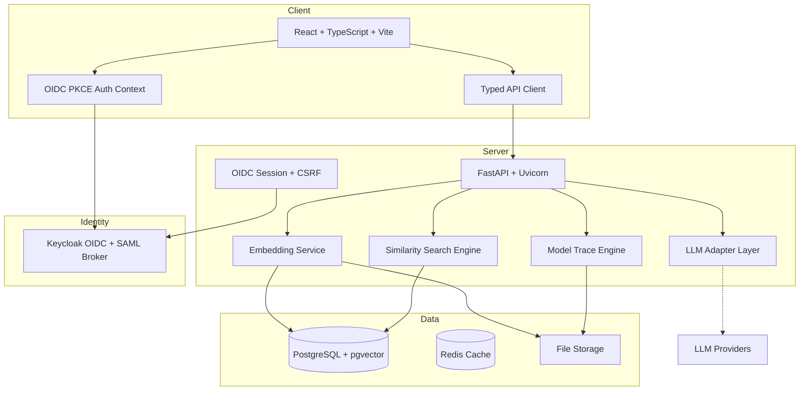

# vector-lens-ryan-vo

> Work in progress. This checkpoint may be incomplete or fail tests. See PLAN.md and STATUS.md before use.


**Ryan Vo | AI & Machine Learning**

A web-based AI/ML debugger for inspecting, searching, and understanding vector embeddings and model internals. Inspired by the multi-process graphical debugging approach of [raddebugger](https://github.com/EpicGames/raddebugger), vector-lens brings interactive debugging workflows to the embedding vector space.

## Problem

Modern AI/ML workflows rely heavily on vector embeddings — for RAG, semantic search, clustering, anomaly detection, and model interpretability. Yet developers lack interactive, graphical tools to debug embedding quality, trace model forward passes, and understand what their vectors actually represent. Existing tools are either batch-oriented (notebooks) or closed-source.

## Approach

vector-lens provides three core workflows in a unified web application:

1. **Embedding Inspector** — Load, browse, search, filter, and export embedding collections (`.npy`, `.npz`, Parquet, JSON). View vector statistics, dimensions, and nearest neighbors.
2. **Similarity Search & Clustering** — Query by vector or text (using a local embedding model). k-NN search with cosine/euclidean/dot metrics. Clustering via k-means and HDBSCAN with exportable results.
3. **Model Trace Debugger** — Load ONNX/TorchScript models and step through layer-by-layer forward passes. Inspect tensor shapes, statistics, histograms, and outliers at each step. Set layer breakpoints.

An optional LLM-powered explanation layer (OpenAI-compatible, Anthropic, Gemini, Ollama) can describe cluster semantics and embedding neighborhoods — advisory only, grounded in actual records.

## Intended Users

ML engineers, researchers, and developers working with embeddings who need a reproducible, offline-first debugging tool that runs locally or in a private cluster.

## Architecture



## Quick Start

### Prerequisites
- Docker 24+ and Docker Compose v2
- Or: Python 3.12, Node 24, PostgreSQL 16, Keycloak 24

### With Docker Compose (Recommended)

```bash
# Clone and configure
git clone https://github.com/A220man/vector-lens-ryan-vo.git
cd vector-lens-ryan-vo
cp .env.example .env
# Edit .env with secure secrets

# Start all services
docker compose up -d --build

# Services:
# - Frontend: http://localhost:5173
# - Backend API: http://localhost:8000
# - Keycloak Admin: http://localhost:8080 (admin/admin)
# - API Docs: http://localhost:8000/docs
```

### Local Development

```bash
# Backend
python3 -m venv .venv
source .venv/bin/activate
pip install -r backend/requirements.txt
cp .env.example .env
# Configure DATABASE_URL=sqlite+aiosqlite:///./vector_lens.db for zero-dep dev
uvicorn backend.app.main:app --reload --host 127.0.0.1 --port 8000

# Frontend (separate terminal)
cd frontend
npm install
npm run dev
# Serves at http://localhost:5173
```

## Configuration

| Variable | Description | Default |
|----------|-------------|---------|
| `DATABASE_URL` | SQLAlchemy async URL (PostgreSQL or SQLite) | `sqlite+aiosqlite:///./vector_lens.db` |
| `SECRET_KEY` | Session/CSRF signing key (32+ bytes hex) | **Required in production** |
| `KEYCLOAK_URL` | Keycloak base URL | `http://localhost:8080` |
| `KEYCLOAK_REALM` | Realm name | `vector-lens` |
| `KEYCLOAK_CLIENT_ID` | Frontend client ID | `vector-lens-frontend` |
| `KEYCLOAK_CLIENT_SECRET` | Frontend client secret | **Required** |
| `OIDC_DISCOVERY_URL` | OIDC discovery endpoint | Auto-derived |
| `OIDC_REDIRECT_URI` | Frontend callback URL | `http://localhost:5173/callback` |
| `LLM_API_KEY` | Optional LLM provider key | (empty = offline mode) |
| `LLM_PROVIDER` | `openai-compatible`, `anthropic`, `gemini`, `ollama` | `openai-compatible` |
| `EMBEDDING_MODEL` | Local sentence-transformers model | `all-MiniLM-L6-v2` |

See `.env.example` for all options.

## API Reference

### Authentication
- `GET /auth/login` — Initiate OIDC login (redirects to Keycloak)
- `GET /auth/callback` — OIDC callback, establishes session
- `POST /auth/logout` — Clear session, redirect to Keycloak logout
- `GET /auth/me` — Current user info (requires auth)

### Embeddings (planned)
- `POST /api/embeddings/collections` — Create collection from uploaded file
- `GET /api/embeddings/collections` — List collections (paginated)
- `GET /api/embeddings/collections/{id}` — Collection details
- `GET /api/embeddings/collections/{id}/vectors` — List vectors (paginated, filterable)
- `GET /api/embeddings/collections/{id}/vectors/{vec_id}` — Single vector detail
- `POST /api/embeddings/collections/{id}/export` — Export vectors (JSON/CSV/npy)

### Similarity Search (planned)
- `POST /api/search/knn` — k-nearest neighbors by vector or text
- `POST /api/search/cluster` — Run clustering on collection
- `GET /api/search/cluster/{id}` — Cluster results

### Model Trace (planned)
- `POST /api/trace/models` — Upload ONNX/TorchScript model
- `POST /api/trace/models/{id}/run` — Execute forward pass with input
- `GET /api/trace/models/{id}/layers` — Layer metadata
- `GET /api/trace/runs/{run_id}/tensors/{layer}` — Tensor at layer

### Health
- `GET /health` — Liveness probe
- `GET /ready` — Readiness probe (DB, Keycloak connectivity)

## AI/ML Evaluation

This section documents reproducible evaluation of the embedding search and clustering workflows.

### Baseline: Embedding Quality on BEIR Benchmark (Planned)

**Command** (to be implemented):
```bash
python -m vector_lens.eval.beir --dataset scifact --model all-MiniLM-L6-v2
```

**Data Provenance**: BEIR benchmark datasets (public, CC-BY-SA 4.0)

**Metrics**: nDCG@10, Recall@100, MRR@10

**Results**: *Not yet measured — will be populated when similarity-search feature is complete*

**Failure Cases**: Short queries, out-of-domain vocabulary, multilingual mismatch

### Clustering Quality (Planned)

**Command**:
```bash
python -m vector_lens.eval.clustering --dataset 20newsgroups --method hdbscan
```

**Metrics**: NMI, ARI, Silhouette

**Results**: *Not yet measured*

## Security Limitations

- **No TLS termination in compose** — Deploy behind a reverse proxy (Traefik, nginx, Caddy) with valid certificates for production
- **Demo mode** — `DEBUG=true` enables unauthenticated access for local development; **refused in production** (`APP_ENV=production`)
- **Secrets** — Never commit `.env`, keys, or databases. Use Docker secrets or vault in production
- **Keycloak** — Default admin/admin credentials must be changed immediately
- **LLM keys** — Server-side only; never exposed to frontend
- **CORS** — Configure `BACKEND_CORS_ORIGINS` explicitly for production domains
- **pgvector** — Requires PostgreSQL with pgvector extension; not available on all managed Postgres

## SSO / SAML Setup

Keycloak supports upstream SAML IdPs via Identity Brokering:

1. In Keycloak Admin Console → Identity Providers → Add SAML v2.0
2. Configure IdP metadata (entity ID, SSO URL, certificates)
3. Map SAML attributes to Keycloak user attributes
4. Set "First Login Flow" to link or create local accounts
5. Test with `docker compose logs keycloak`

See `docs/saml-setup.md` for detailed steps (planned).

## Provider Configuration Table

| Provider | Base URL | Models | Auth |
|----------|----------|--------|------|
| OpenAI | `https://api.openai.com/v1` | gpt-4o, gpt-4o-mini | Bearer token |
| OpenRouter | `https://openrouter.ai/api/v1` | Various | Bearer token |
| Ollama | `http://localhost:11434/v1` | Local models | None (local) |
| Anthropic | `https://api.anthropic.com` | claude-3-* | `x-api-key` header |
| Gemini | `https://generativelanguage.googleapis.com` | gemini-* | Bearer token |

All configurable via `LLM_PROVIDER`, `LLM_BASE_URL`, `LLM_MODEL`, `LLM_API_KEY`.

## Backup / Restore

```bash
# Backup PostgreSQL
docker compose exec db pg_dump -U postgres vector_lens > backup.sql

# Restore
docker compose exec -T db psql -U postgres vector_lens < backup.sql

# Backup uploads
tar -czf uploads-backup.tar.gz ./data/uploads
```

## Development

### Running Tests

```bash
# Backend
source .venv/bin/activate
PYTHONPATH=backend pytest backend/tests -v

# Frontend
cd frontend
npm run test
```

### Linting / Typechecking

```bash
# Backend
ruff check backend/
mypy backend/

# Frontend
cd frontend
npm run lint
npm run typecheck
```

## Changelog

See [CHANGELOG.md](CHANGELOG.md).

## License

MIT © 2026 Ryan Vo <ryandtvo@gmail.com>